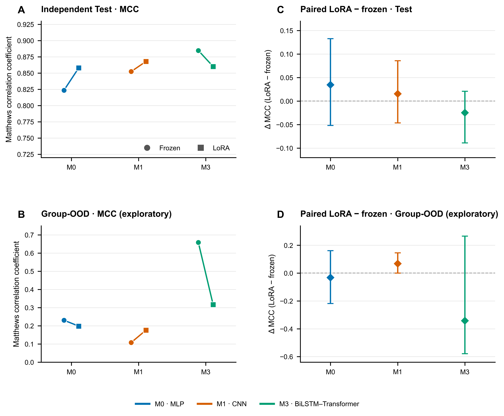
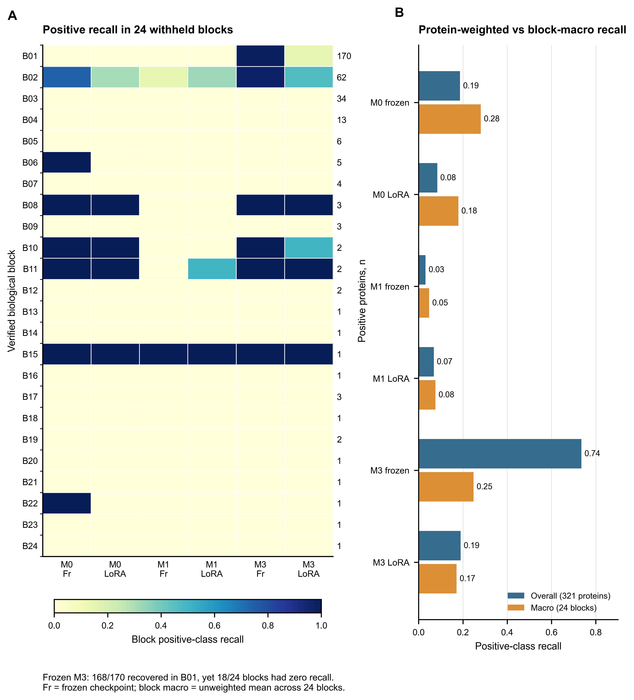
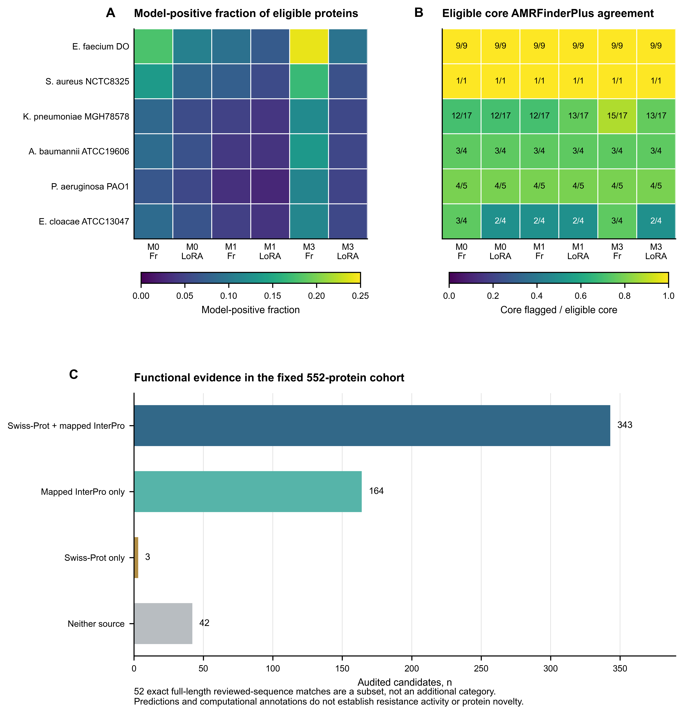

# Biological Generalization of Protein Language Models for Antimicrobial Resistance with ESKAPE Proteome Applications

[](https://github.com/ishavats28/amr-plm-generalization/releases/latest)
[](https://doi.org/10.5281/zenodo.24325723)
[](LICENSE)

This repository accompanies a study of how protein language model classifiers behave on proteins separated by homology and on biologically withheld resistance groups. It releases verified supplementary results, three final publication figures, and selected scientific implementations. Raw training sequences, trained checkpoints, and database installations are not included.

## Scientific question and design

The classification dataset contains **15,794 proteins in 2,688 homology components**. Components were kept disjoint across training (12,152 proteins), validation (1,500), independent Test (1,500), and Group-OOD (642). Group-OOD withholds 24 biological blocks and is an exploratory test of transfer beyond training groups.

Eight frozen-encoder classifiers combine [ESM-2](https://huggingface.co/facebook/esm2_t33_650M_UR50D) or [ProtBERT](https://huggingface.co/Rostlab/prot_bert) representations with an MLP, multiscale CNN, Transformer/attention, or BiLSTM–Transformer head. ESM-2 models M0 (MLP), M1 (CNN), and M3 (BiLSTM–Transformer) were adapted with rank-8 LoRA in three independent runs per architecture. Checkpoints were selected by validation loss. Six selected frozen and LoRA checkpoints generated the 12 Test and Group-OOD evaluations.

## Principal findings

- Adaptation effects depended on the classifier head. On Test, MCC changed from 0.824 to 0.858 for M0, 0.852 to 0.868 for M1, and 0.885 to 0.860 for M3. The archived paired component-bootstrap interval for the M1 MCC difference crosses zero (95% interval: −0.0464 to 0.0860), so that contrast does not support a directional claim.
- Group-OOD performance differed substantially from independent Test performance. Frozen M3 recovered 236 of 321 Group-OOD positives, but 168 of those 236 recoveries came from the largest block (168 of its 170 positives); 18 of 24 blocks had zero recall. Protein-weighted and block-macro summaries answer different questions.
- Six ESKAPE reference proteomes contained **24,855 model-inference-eligible proteins**. Their model-positive fractions and agreement with small sets of eligible core AMRFinderPlus annotations are exploratory computational results, not measured resistance sensitivity or proteome-wide accuracy.
- The fixed **552-protein** candidate cohort was characterized with reviewed Swiss-Prot and InterProScan evidence. Mapped evidence categories are both sources (343), InterPro only (164), Swiss-Prot only (3), and neither (42). The 52 exact full-length reviewed-sequence matches are a subset of the cohort. Sequence similarity and domain signatures do not establish experimentally verified AMR function or novelty.

## Publication figures



**Figure 1.** Frozen and LoRA MCC comparisons with archived paired component-bootstrap intervals.



**Figure 2.** Block-level recovery and the distinction between protein-weighted and block-macro recall.



**Figure 3.** Whole-proteome model-positive fractions, core-annotation agreement, and evidence categories in the 552-protein cohort.

The [complete approved legends](figures/FIGURE_LEGENDS.md), vector PDFs, and [Figure 2 block-to-component mapping export](figures/data/Figure_2_heatmap_data.csv) are in the figures directory.

## Repository contents

- [Scientific scripts](scripts/README.md): dataset construction and verification; frozen and LoRA training; held-out and ESKAPE evaluation; Group-OOD block analysis; annotation processing. Eight frozen configurations and the LoRA protocol accompany the code.
- [Supplementary datasets](data/supplementary/README.md): complete S1–S5 machine-readable results and a [data dictionary](data/supplementary/SUPPLEMENTARY_DATA_DICTIONARY.md).
- [Editable Word supplement](supplementary/Supplementary_Tables_S1-S5.docx).
- [Publication figures](figures/README.md): three final PNG/PDF figure pairs and approved legends. Figure-generation code is not distributed.
- [Reproducibility notes](REPRODUCIBILITY.md): input requirements, execution scope, and validated lightweight commands.

## Installation and practical use

Use Python 3 and install dependencies in an environment appropriate for your CPU or GPU:

```bash
python -m pip install -r requirements.txt
python scripts/evaluation/locked_holdout.py --self-test
python scripts/evaluation/eskape_inference.py --self-test
```

These self-tests exercise inference-policy logic without downloading weights or running model inference. Full training and evaluation need the original input layout, selected checkpoints, pinned encoders, and sufficient compute. The repository is **not** a one-command end-to-end reproduction environment; see [REPRODUCIBILITY.md](REPRODUCIBILITY.md).

## Data, citation, and license

The validated supplementary datasets, publication figures, and selected scientific implementations are available in this repository. The initial publication release (v1.0.0) is permanently archived on Zenodo.

**Software citation**

Vats, I. (2026). *AMR Protein Language Model Generalization* (Version 1.0.0) [Computer software]. Zenodo. https://doi.org/10.5281/zenodo.24325723

The version-specific DOI identifies the archived v1.0.0 release. Software citation metadata are also provided in [CITATION.cff](CITATION.cff).

Original repository software is distributed under the [MIT License](LICENSE). Third-party data, pretrained models, and database resources remain subject to their respective licenses and attribution requirements. See the [supplementary data documentation](data/supplementary/README.md) and [reproducibility guide](REPRODUCIBILITY.md) for further details.
